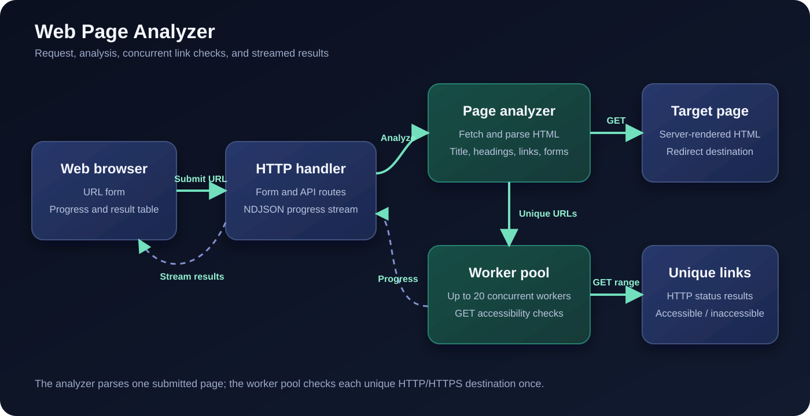

# Web Page Analyzer

A small Go web application that accepts a URL and reports useful information about the server-rendered HTML page. Link accessibility checks run concurrently through a bounded worker pool, while the browser displays live progress.

## Features

- Detects the HTML version and page title.
- Counts H1 through H6 headings.
- Counts internal and external link occurrences.
- Checks every unique HTTP/HTTPS link for accessibility.
- Detects likely login forms by looking for password inputs.
- Streams link-checking progress to a responsive web interface.
- Handles redirects, network failures, invalid URLs, and analysis timeouts.

## Technologies used

| Technology | Purpose |
| --- | --- |
| Go 1.27.3 | Application language and concurrency support |
| `net/http` | HTTP server, page requests, and link checks |
| `html/template` and `embed` | Server-rendered and embedded web interface |
| `golang.org/x/net/html` | HTML parsing and document inspection |
| HTML, CSS, and JavaScript | Responsive browser interface |
| Fetch API and NDJSON | Live progress and result streaming |
| Docker | Reproducible container build and runtime |
| GitHub Actions | Automated formatting, vetting, testing, and build checks |

## Project structure

```text
cmd/web-analyser/          Application entry point and server configuration
internal/analyzer/         Page fetching, HTML parsing, and analysis rules
internal/linkchecker/      Bounded concurrent link-checking worker pool
internal/web/              HTTP handlers and embedded HTML interface
Dockerfile                 Multi-stage container build
Makefile                   Common development commands
```

## Prerequisites

For local development:

- Git, to clone the repository.
- Go 1.27.3 or newer.
- An available local port `8080`.
- Internet access when analyzing public websites.

For the container workflow, install Docker Desktop or Docker Engine. Go does not need to be installed when running only with Docker.

## Run locally

```bash
git clone https://github.com/kaweendras/web-analyser-go.git
cd web-analyser-go
go mod download
go run ./cmd/web-analyser
```

Open [http://localhost:8080](http://localhost:8080), enter a complete HTTP or HTTPS URL, and select **Analyze page**.

To create a local binary:

```bash
go build ./cmd/web-analyser
```

On Windows PowerShell, the output executable will be `web-analyser.exe`.

## Run with Docker

```bash
docker build -t web-analyser .
docker run --rm -p 8080:8080 web-analyser
```

Then open [http://localhost:8080](http://localhost:8080). The container runs as a non-root user and includes the CA certificates required for HTTPS checks.

## Architecture



The HTTP handler serves the embedded interface and passes submitted URLs to the analyzer. The analyzer parses the target page, extracts unique links, and sends them to the bounded worker pool. Progress and final or partial results are streamed back to the browser.

## API endpoints

| Method | Endpoint | Request | Response |
| --- | --- | --- | --- |
| `GET` | `/` | None | HTML analyzer interface |
| `POST` | `/` | Form field `url` | HTML page containing the result or error |
| `POST` | `/api/analyze` | Form field `url` | `application/x-ndjson` progress and result stream |

The URL must include an `http://` or `https://` scheme. The streaming endpoint can emit `status`, `progress`, `result`, `partial`, or `error` events. A `partial` event contains the data collected before an analysis timeout.

Example request:

```bash
curl -N -X POST \
  -H "Content-Type: application/x-www-form-urlencoded" \
  --data-urlencode "url=https://example.com" \
  http://localhost:8080/api/analyze
```

## Tests

```bash
go test ./...
go vet ./...
go test -cover ./...
```

Tests use local `httptest` servers and fake dependencies rather than making requests to public websites.

## Real-world applications and opportunities

- **Pre-release website QA:** Check a page's structure and link health before deployment.
- **Content migration validation:** Compare pages after a redesign or CMS migration to catch missing headings and broken destinations.
- **SEO and content audits:** Review titles, heading hierarchy, and internal versus external link usage.
- **Campaign and landing-page checks:** Validate important links before publishing marketing pages.
- **CI/CD quality checks:** Run automated page analysis after a staging deployment and fail a build when important links are inaccessible.
- **Monitoring services:** Extend the analyzer into a scheduled service that alerts site owners when page structure or link availability changes.

## Further development

- Show each inaccessible URL with its status code or network error.
- Add configurable worker limits, timeouts, retries, and per-domain rate limiting.
- Store analysis history and allow reports to be exported as JSON or CSV.
- Add scheduled scans, notifications, and comparisons between previous results.
- Support JavaScript-rendered pages through an optional browser-based analyzer.
- Add authentication, API rate limiting, and private-network URL protection before public deployment.
- Extend continuous integration with Docker image builds and vulnerability scanning.
