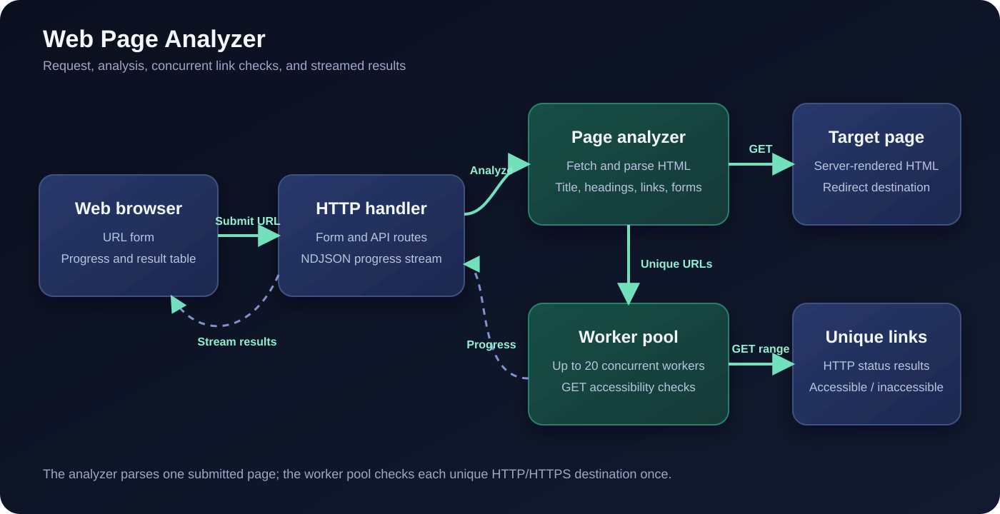

# Web Page Analyzer

A small Go web application that accepts a URL and reports useful information about the server-rendered HTML page. Link accessibility checks run concurrently through a bounded worker pool, while the browser displays live progress.

## Features

- Detects the HTML version and page title.
- Counts H1 through H6 headings.
- Counts internal and external link occurrences.
- Checks every unique HTTP/HTTPS link for accessibility.
- Detects likely login forms by looking for password inputs.
- Streams link-checking progress to a responsive web interface.
- Handles redirects, network failures, invalid URLs, and analysis timeouts.

## Project structure

```text
cmd/web-analyser/          Application entry point and server configuration
internal/analyzer/         Page fetching, HTML parsing, and analysis rules
internal/linkchecker/      Bounded concurrent link-checking worker pool
internal/web/              HTTP handlers and embedded HTML interface
Dockerfile                 Multi-stage container build
Makefile                   Common development commands
```

## Run locally

### Requirements

- Go 1.27 or newer

### Steps

```bash
git clone https://github.com/kaweendras/web-analyser-go.git
cd web-analyser-go
go mod download
go run ./cmd/web-analyser
```

Open [http://localhost:8080](http://localhost:8080), enter a complete HTTP or HTTPS URL, and select **Analyze page**.

To create a local binary:

```bash
go build ./cmd/web-analyser
```

On Windows PowerShell, the output executable will be `web-analyser.exe`.

## Run with Docker

### Requirements

- Docker Desktop or Docker Engine

### Steps

```bash
docker build -t web-analyser .
docker run --rm -p 8080:8080 web-analyser
```

Then open [http://localhost:8080](http://localhost:8080). The container runs as a non-root user and includes the CA certificates required for HTTPS checks.

## Tests

```bash
go test ./...
go vet ./...
go test -cover ./...
```

Tests use local `httptest` servers and fake dependencies rather than making requests to public websites.

## Real-world applications and opportunities

- **Pre-release website QA:** Check a page's structure and link health before deployment.
- **Content migration validation:** Compare pages after a redesign or CMS migration to catch missing headings and broken destinations.
- **SEO and content audits:** Review titles, heading hierarchy, and internal versus external link usage.
- **Campaign and landing-page checks:** Validate important links before publishing marketing pages.
- **CI/CD quality checks:** Run automated page analysis after a staging deployment and fail a build when important links are inaccessible.
- **Monitoring services:** Extend the analyzer into a scheduled service that alerts site owners when page structure or link availability changes.

## Further development

- Show each inaccessible URL with its status code or network error.
- Add configurable worker limits, timeouts, retries, and per-domain rate limiting.
- Store analysis history and allow reports to be exported as JSON or CSV.
- Add scheduled scans, notifications, and comparisons between previous results.
- Support JavaScript-rendered pages through an optional browser-based analyzer.
- Add authentication, API rate limiting, and private-network URL protection before public deployment.
- Add continuous integration for tests, static analysis, and Docker image builds.

## Architecture diagram


